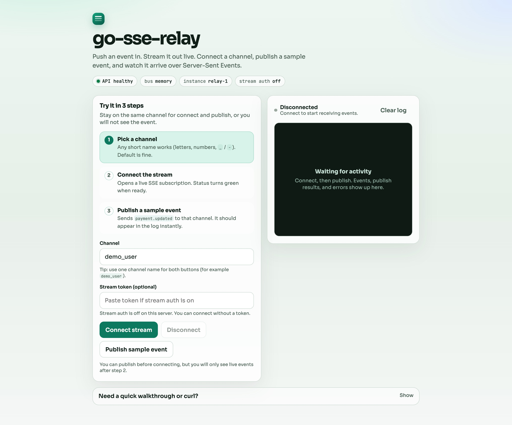
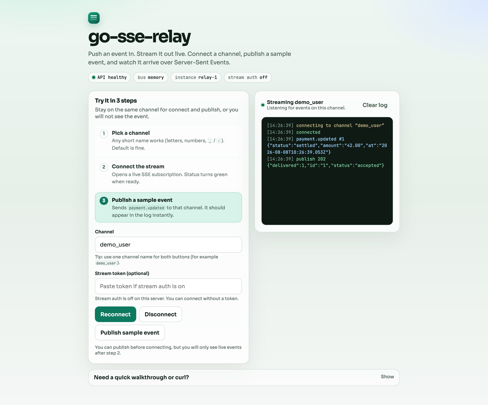

# go-sse-relay

Push an event in. Stream it out live.

`go-sse-relay` is a small Go service for the common “async callback finished, client UI should update” problem. Producers `POST` JSON into a channel. Browsers or apps listen with Server-Sent Events. Optional signed stream tokens lock a channel. Optional Redis or NATS fan-out covers more than one instance.

Repo: https://github.com/o-mid/go-sse-relay

## Live demo

**https://go-sse-relay-production.up.railway.app**

Open the page, click **Connect stream**, then **Publish sample event**.





```bash
curl -N 'https://go-sse-relay-production.up.railway.app/v1/stream?channel=demo_user'
curl -s -X POST 'https://go-sse-relay-production.up.railway.app/v1/hooks/demo_user' \
  -H 'Content-Type: application/json' \
  -d '{"type":"payment.updated","data":{"status":"settled"}}'
```

## Quick start

```bash
git clone git@github.com:o-mid/go-sse-relay.git
cd go-sse-relay
cp .env.example .env
make run
```

Open http://127.0.0.1:8080/

1. Click **Connect stream**
2. Click **Publish sample event**
3. Watch the event show up in the log

```bash
curl -N 'http://127.0.0.1:8080/v1/stream?channel=demo_user'
curl -s -X POST 'http://127.0.0.1:8080/v1/hooks/demo_user' \
  -H 'Content-Type: application/json' \
  -d '{"type":"payment.updated","data":{"status":"settled","amount":"12.50"}}'
```

## Install

```bash
go run github.com/o-mid/go-sse-relay/cmd/relay@v0.2.0
```

```bash
go install github.com/o-mid/go-sse-relay/cmd/relay@v0.2.0
```

## Stream auth

Set `STREAM_SECRET` to require a signed channel token on `/v1/stream`.

Mint:

```bash
export STREAM_SECRET=stream-secret
export TOKEN_MINT_SECRET=mint-secret
make run

curl -s -X POST http://127.0.0.1:8080/v1/tokens \
  -H "Authorization: Bearer mint-secret" \
  -H 'Content-Type: application/json' \
  -d '{"channel":"demo_user","ttl_seconds":3600}'
```

Subscribe with `?token=...` (see [docs/auth.md](docs/auth.md)).

## Multi-instance bus

```bash
docker compose up -d redis
INSTANCE_ID=relay-a BUS=redis REDIS_URL=redis://127.0.0.1:6379/0 LISTEN_ADDR=127.0.0.1:8080 make run
INSTANCE_ID=relay-b BUS=redis REDIS_URL=redis://127.0.0.1:6379/0 LISTEN_ADDR=127.0.0.1:8081 make run
```

Or `BUS=nats` with `NATS_URL`. Details: [docs/bus.md](docs/bus.md).

## API at a glance

| Method | Path | Purpose |
| --- | --- | --- |
| `GET` | `/healthz` | Liveness + bus / auth flags |
| `POST` | `/v1/hooks/{channel}` | Ingest one event |
| `POST` | `/v1/tokens` | Mint a stream token |
| `GET` | `/v1/stream?channel=...` | SSE subscribe |
| `GET` | `/` | Demo UI |

## Docs

| Doc | Contents |
| --- | --- |
| [docs/concepts.md](docs/concepts.md) | Channels, fan-out, replay |
| [docs/api.md](docs/api.md) | HTTP reference and env vars |
| [docs/auth.md](docs/auth.md) | Signed stream tokens |
| [docs/bus.md](docs/bus.md) | Redis / NATS multi-instance |
| [docs/architecture.md](docs/architecture.md) | Flow + capability map |
| [CHANGELOG.md](CHANGELOG.md) | Release notes |

## Capability map

| Capability | Path |
| --- | --- |
| Channel rules | `internal/channel` |
| Fan-out hub | `internal/hub` |
| Replay buffer | `internal/buffer` |
| Ingest HMAC | `internal/auth` |
| Stream tokens | `internal/streamtoken` |
| Memory / Redis / NATS bus | `internal/bus` |
| Hook + SSE + mint HTTP | `internal/api` |
| Embedded demo | `internal/webui` |
| Entrypoint | `cmd/relay` |

## Develop

```bash
make test
make vet
make build
```

## Docker

```bash
docker build -t go-sse-relay .
docker run --rm -p 8080:8080 go-sse-relay
```

## License

MIT
